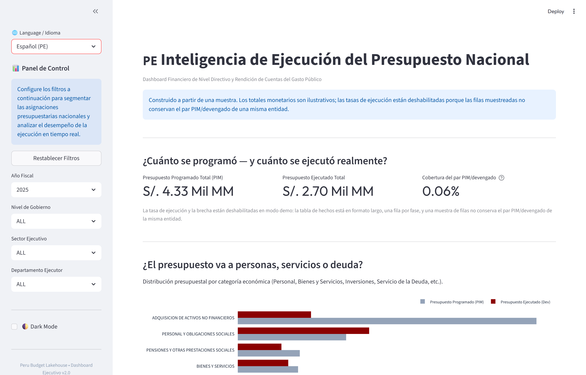
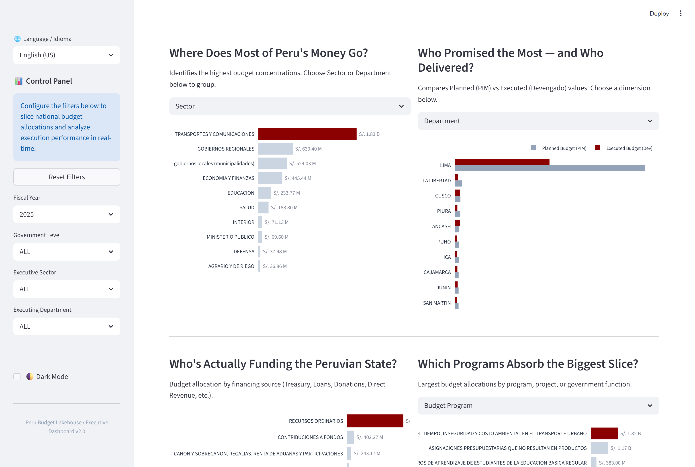
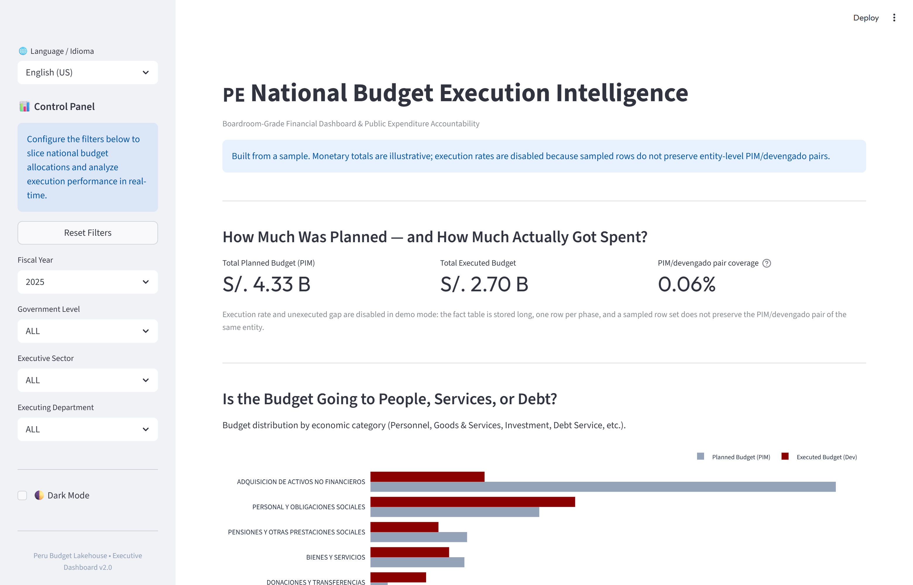

# Peru Budget Lakehouse

**Pipeline de analytics engineering que convierte el archivo de ejecución presupuestaria del Perú — 8.002.563 filas en 88 columnas — en un esquema estrella Kimball de 29.530.978 filas, un dashboard ejecutivo bilingüe y una capa conversacional que responde preguntas de presupuesto en SQL.**

[English](README.md) · **Español**

---

## Vista del Dashboard







Las vistas se ejecutan sobre la muestra de 450.000 filas incluida en `data/00_demo/`.
Por qué el modo demo deshabilita dos KPIs está documentado en [Limitaciones conocidas](#limitaciones-conocidas).

---

## El Problema de Negocio

El Ministerio de Economía y Finanzas del Perú publica la ejecución presupuestaria como una única hoja ancha: 88 columnas, una por fase y por año fiscal (`pia_2022`, `pim_2022`, `devengado_2022`, … `girado_2026`). Cada pregunta que un analista financiero realmente necesita — *¿qué regiones ejecutan menos?*, *¿qué parte del presupuesto programado se gastó de verdad?*, *¿quién financia al Estado?* — exige primero reordenar 35 columnas financieras en una forma utilizable.

Ahí es donde se pierde el trabajo. Cada respuesta se reconstruye desde cero: una tabla dinámica nueva, una cadena nueva de búsquedas, una conciliación que nadie dejó por escrito. Los números se mueven entre copias y nadie puede decir cuál archivo es la verdad.

Este pipeline hace esa reestructuración una sola vez y convierte una tabla conciliada en la única fuente para cada respuesta posterior: reportes SQL, dashboard y capa conversacional.

El dominio no es teórico: viene de años auditando estados financieros, conciliando libros mayores y probando controles, donde un céntimo sin explicar entre dos reportes es un hallazgo, no un redondeo.

## Los Datos

| | |
|---|---|
| Fuente | [Datos abiertos MEF — Comparación de Presupuesto y Ejecución de Gasto](https://datosabiertos.mef.gob.pe/dataset/comparacion-de-presupuesto-ejecucion-gasto) |
| Archivo crudo | 8.002.563 filas × 88 columnas |
| Columnas financieras | 35 (7 fases × 5 años fiscales) |
| Tabla de hechos Gold | **29.530.978** filas |
| Tablas de dimensión | 5 — geografía 1.892 · institución 2.905 · programática 345.402 · económica 579 · financiamiento 316 |
| Años fiscales | 2022–2026; 2026 es dato clonado de la fuente y se excluye de toda consulta |
| Grano | una fila por institución × geografía × programa × clasificador económico × fuente de financiamiento × año × fase |

Cada cifra proviene de una ejecución registrada en los notebooks, no de una estimación. Las fuentes están en [De dónde salen los números](#de-dónde-salen-los-números).

## Arquitectura

```
CSV CRUDO  (8.002.563 filas × 88 columnas)
        │
        ▼
┌──────────────────────────────────────┐
│ BRONZE — Polars streaming            │
│ CSV → Parquet (ZSTD), sin carga total│
└───────────────┬──────────────────────┘
                ▼
┌──────────────────────────────────────┐
│ SILVER — normalización               │
│ nombres, tipos, mayúsculas, acentos  │
└───────────────┬──────────────────────┘
                ▼
┌──────────────────────────────────────┐
│ SILVER — unpivot                     │
│ DuckDB: 35 columnas anchas → largo   │
│ → 29.530.978 hechos (fase, año)      │
└───────────────┬──────────────────────┘
                ▼
┌──────────────────────────────────────┐
│ GOLD — esquema estrella Kimball      │
│ 1 hecho + 5 dimensiones, SK wyhash   │
└──────┬───────────────────────────────┘
       │
  ┌────┴─────────────────────┐
  ▼                          ▼
GATE QA                 Dashboard Streamlit
Σ Silver = Σ Gold       reportes DuckDB deterministas
diferencia S/. 0.00     conversacional NL → SQL → respuesta
```

La orquestación es un flujo Prefect con dependencias explícitas `wait_for=`: una etapa no puede empezar antes de que termine la anterior, sin importar la configuración del planificador.

## Decisiones de Ingeniería

**Polars en streaming en lugar de Pandas.**
`scan_csv` / `sink_parquet` leen y escriben por lotes; la fuente de 88 columnas nunca se materializa completa. El costo es una API más estrecha y sin comodidades de DataFrame: se escriben planes, no bucles. Es aceptable porque el trabajo debe correr en una estación de trabajo, no en un clúster.

**DuckDB se encarga de una sola transformación.**
Reordenar 35 columnas anchas a formato largo es el pico de memoria de todo el pipeline. El `UNPIVOT` vectorizado de DuckDB corre bajo un `PRAGMA memory_limit` explícito con derrame a directorio temporal, de modo que la operación degrada en velocidad en lugar de fallar. Polars controla el resto. Dos motores en lugar de uno es el precio; el modo de fallo es la razón.

**`polars-hash` en lugar de `pl.hash()`.**
`pl.hash()` no garantiza una salida idéntica entre versiones de Polars. Un salto de versión rompería en silencio cada clave foránea entre hechos y dimensiones: los joins devuelven cero filas, sin error. Las claves wyhash son estables entre versiones y siguen ejecutándose dentro del motor de streaming, a diferencia de `map_elements`.

**`ignore_nulls=True` en las claves subrogadas: un bug real, no una precaución.**
Las entidades municipales suelen tener `pliego = NULL`. Sin `ignore_nulls=True`, un solo NULL colapsa la expresión de clave concatenada a NULL y miles de municipalidades comparten la misma clave. Colisión silenciosa y agregados de apariencia plausible. La corrección está en `src/etl_04_star_schema.py:111` y `:137`.

**La conciliación es un gate, no una advertencia.**
El pipeline suma `monto` en Silver y en Gold y lanza `ValueError` cuando `abs(Σ silver − Σ gold) > 0.01` (`src/etl_05_data_quality_audit.py:23`). Ningún reporte se ejecuta hasta que las dos capas cuadren. Es la lógica de control de un sistema contable aplicada a un pipeline de datos: no hay salida aguas abajo mientras los números no coincidan.

## Gates de Calidad de Datos

| Gate | Lógica | Si falla |
|---|---|---|
| Conciliación financiera | `abs(Σ Silver − Σ Gold) ≤ S/. 0.01` | `ValueError`, el pipeline se detiene |
| Volumetría de filas | filas limpias de Silver == filas del hecho en Gold | Se registra advertencia con la diferencia |
| Seguridad SQL | solo `SELECT`/`WITH`, 22 palabras prohibidas (`sqlparse`) | Consulta rechazada antes de ejecutarse |
| Semántica SQL | alcance de columnas, consistencia de agregación, grafo de CTE, grano | Consulta rechazada antes de ejecutarse |

La última corrida completa registrada concilió ambas capas en **S/ 5.373.286.978.810,52** con una diferencia de **S/ 0.00**.

## Qué Dicen los Datos

Todas las cifras provienen de la última corrida completa registrada y guardada en `notebooks/`.

**El presupuesto programado creció 17,0% en cuatro años.** El PIM pasó de S/ 147,06 mil millones en 2022 a S/ 172,07 mil millones en 2025.

**La ejecución de 2022 fue 88,6%.** S/ 130,29 mil millones devengados sobre S/ 147,06 mil millones de PIM; el 11,4% restante es la brecha entre lo presupuestado y lo efectivamente gastado.

**El gasto está concentrado geográficamente por construcción.** En 2024 las unidades ejecutoras de Lima reportaron S/ 91,43 mil millones devengados; Cusco, el segundo departamento, reportó S/ 5,63 mil millones: una diferencia de 16,2 veces. Los ministerios nacionales ejecutan en Lima, así que esto es una propiedad del Estado peruano, no un artefacto de los datos.

**2026 es un clon de 2025.** El PIM de ambos años es S/ 172,067633 mil millones hasta el último dígito. El pipeline reconoce la duplicación en lugar de promediarla en silencio: la capa analítica agrega `anio <= 2025` a toda consulta generada.

## Analítica Conversacional

Lenguaje natural → SQL → DuckDB → respuesta ejecutiva estructurada. Dos llamadas al LLM por pregunta sobre Groq (`llama-3.3-70b-versatile`):

1. **Traducir** — una descripción de esquema de 205 líneas, reglas de negocio y 7 ejemplos resueltos producen SQL.
2. **Sintetizar** — pregunta, SQL y filas de resultado producen JSON estructurado: intención, métrica principal, especificación de gráfico, hallazgos y preguntas de seguimiento.

Dos validadores independientes corren entre la generación y la ejecución: `QueryValidationPolicy` (una sola sentencia, solo `SELECT`/`WITH`, 22 palabras prohibidas) y `SQLSemanticContractValidator` (alcance de columnas, consistencia de agregación, grafo de dependencias de CTE, familia de grano). El modelo nunca ve datos crudos.

La interfaz es completamente bilingüe: cada etiqueta, gráfico y respuesta sigue al selector de idioma.

## Cómo Ejecutarlo

**Docker** — sin Python local:

```bash
git clone https://github.com/DaelFame/peru-budget-lakehouse.git
cd peru-budget-lakehouse
docker build -t peru-budget-lakehouse .
docker run -p 8501:8501 peru-budget-lakehouse
```

Dashboard en `http://localhost:8501`, servido desde la capa demo incluida en la imagen. Para usar tu propia capa Gold:

```bash
docker run -p 8501:8501 -v "$(pwd)/data:/app/data" peru-budget-lakehouse
```

**Local:**

```bash
uv sync
uv run streamlit run app.py
```

**Pipeline completo** — requiere el CSV de origen en `data/01_bronze/comparativo_gastos_2022_2026.csv` (descárgalo del portal del MEF; ni el CSV ni la capa Gold están versionados):

```bash
uv run python main.py
```

Las etapas individuales se ejecutan igual:

```bash
uv run python src/etl_01_bronze_ingestion.py
uv run python src/etl_02_silver_cleaning.py
uv run python src/etl_03_silver_unpivot.py
uv run python src/etl_04_star_schema.py
uv run python src/etl_05_data_quality_audit.py
uv run python src/etl_06_analytical_reports.py
```

La capa conversacional necesita `GROQ_API_KEY`. Sin ella el dashboard sigue mostrando todas las vistas deterministas y lo indica.

**Tests:** `uv run pytest` — 131 tests, incluida una ejecución de extremo a extremo del dashboard y los gates de aceptación del muestreo demo.

## Limitaciones Conocidas

**La demo versionada es una muestra por fila, y el dashboard lo dice.** Extraer filas individuales de una tabla de hechos en formato largo conserva un hecho `pim` y descarta el hecho `devengado` de la misma entidad. El cociente entonces compara entidades distintas: la muestra publicada reporta tasas de ejecución imposibles. Por eso el modo demo oculta la tasa de ejecución y la brecha no ejecutada, explica el motivo en la tarjeta y muestra en su lugar la cobertura del par PIM/devengado: la proporción de entidades-año que efectivamente tienen ambas fases. En la muestra versionada esa cobertura es 0,06%; una muestra correcta por entidad reporta una tasa válida. Los totales monetarios siguen visibles y están etiquetados como ilustrativos: son un subconjunto del libro real, no el total nacional.

**Regenerar la demo correctamente.** `scripts/build_demo_dataset.py` ahora muestrea entidades completas — conserva todos los años y fases de cada registro seleccionado — y se niega a escribir una demo cuya tasa de ejecución global o por año salga de [0, 100]. La concentración geográfica se reporta, nunca se impone: Lima concentra el PIM porque los ministerios nacionales ejecutan allí. Ejecútalo en una máquina que tenga `data/03_gold/`:

```bash
uv run python scripts/build_demo_dataset.py
```

Escribe `data/00_demo/*.parquet` más `manifest.json` con parámetros, conteos y validación. `uv run python scripts/demo_stats.py` vuelve a derivar cada cifra de la demo citada aquí.

**No hay benchmark versionado.** El pipeline registra la duración de cada etapa en nivel `INFO`; en este README no aparece ninguna cifra de tiempo o memoria porque no hay JSON de corrida en el repositorio. Ejecuta `uv run python main.py` para obtener números en tu hardware.

**La imagen Docker no se construye en CI.** Los comandos documentados funcionan con la estructura del repositorio; la construcción de la imagen no está verificada aquí.

**159.981 filas de origen comparten un `KEY_VALUE` duplicado (2,0% del archivo).** Se conservan, no se descartan en silencio: el gate de conciliación compara Silver contra Gold, así que no puede detectar un duplicado que llega a ambas capas. Deduplicar requiere una regla de negocio que la fuente no provee.

**`GrainRouter` no está conectado al motor.** La clasificación de grano previa al LLM existe y está cubierta por tests, pero `AIEngine.ask()` todavía no la llama. Los filtros de la barra lateral tampoco se pasan al contexto del LLM.

**2026 se excluye, no se corrige.** La fuente repite 2025 en las columnas de 2026; el pipeline lo filtra en lugar de intentar reparar la exportación.

## De Dónde Salen los Números

| Cifra | Fuente |
|---|---|
| 8.002.563 filas de origen; 159.981 claves duplicadas | `notebooks/01_ingesta_silver.ipynb:335-337` |
| 88 columnas; 35 columnas financieras | `notebooks/01_ingesta_silver.ipynb:181`, `:607` |
| 29.530.978 filas en el hecho | `notebooks/02_modelado_gold.ipynb:448`, `notebooks/03_auditoria_calidad.ipynb:220` |
| Cardinalidad de dimensiones | `notebooks/02_modelado_gold.ipynb:61, 135, 210, 287, 366` |
| Total conciliado y diferencia | `notebooks/03_auditoria_calidad.ipynb:64-66` |
| PIM por año fiscal; devengado 2022 | `notebooks/04_reportes_gerenciales.ipynb:156-160`, `notebooks/03:134` |
| Devengado 2024 de Lima y Cusco | `notebooks/04_reportes_gerenciales.ipynb:90-91` |
| Conteos y cobertura de la demo | `uv run python scripts/demo_stats.py` |
| 22 palabras prohibidas; 7 ejemplos; esquema de 205 líneas | `src/dashboard/ai_engine.py:30-35`, `:174-263`, `:60-264` |
| 131 tests | `uv run pytest` |

## Qué Leer Primero

| Archivo | Qué demuestra |
|---|---|
| `src/etl_03_silver_unpivot.py` | La reestructuración sin memoria acotada, delegada a DuckDB |
| `src/etl_04_star_schema.py` | Claves subrogadas, `ignore_nulls=True`, dimensiones en streaming |
| `src/etl_05_data_quality_audit.py` | La conciliación como gate duro |
| `src/dashboard/semantic_contract.py` | Validación SQL: alcance, agregación, grafo de CTE, grano |
| `src/dashboard/ai_engine.py` | Pipeline de dos llamadas NL→SQL→respuesta y su contrato de prompt |
| `scripts/build_demo_dataset.py` | Muestreo por entidad con gates de aceptación |
| `main.py` | Cadena de dependencias `wait_for=` de Prefect |

## Estructura del Repositorio

```
peru-budget-lakehouse/
├── main.py                     Punto de entrada de la orquestación Prefect
├── app.py                      Dashboard Streamlit (bilingüe)
├── src/
│   ├── config.py               Rutas, detección de hardware, resolvedor demo/producción
│   ├── etl_01..06              Bronze → Silver → Gold → QA → reportes
│   ├── dashboard/              Consultas, componentes, motor de IA, validador semántico
│   └── observability/          Modelo de trazas de ejecución de consultas
├── scripts/                    Constructor de demo, estadísticas, verificador de determinismo
├── tests/                      131 tests
├── sql/                        Cuatro reportes ejecutivos
├── notebooks/                  Análisis exploratorio con salidas registradas
├── data/00_demo/               Capa demo versionada de 450.000 filas
└── assets/                     Capturas del dashboard
```

`data/01_bronze/`, `data/02_silver/` y `data/03_gold/` están en `.gitignore`: los regenera el pipeline.

## Stack

| Herramienta | Rol |
|---|---|
| Polars | Ingesta y normalización en streaming |
| DuckDB | UNPIVOT y OLAP embebido sobre Parquet |
| polars-hash | Claves subrogadas wyhash estables entre versiones |
| Prefect | Orquestación con dependencias explícitas |
| Groq / llama-3.3-70b | Traducción NL→SQL y síntesis de respuestas |
| Streamlit + Plotly | Dashboard e interfaz conversacional |
| Parquet + ZSTD | Almacenamiento columnar con poda de predicados |
| Docker | Entorno reproducible |
| GitHub Actions | CI: suite completa en cada push y PR |
| uv | Resolución de dependencias y lockfile |

## Hoja de Ruta

- [x] Pipeline medallion: Bronze → Silver → Gold, streaming en cada capa
- [x] Esquema estrella Kimball: 1 hecho + 5 dimensiones con claves subrogadas estables
- [x] Conciliación financiera como gate bloqueante
- [x] Orquestación Prefect con orden explícito
- [x] Capa de reportes DuckDB determinista
- [x] Dashboard bilingüe con analítica conversacional y guardas SQL
- [x] Muestreador de demo por entidad con gates de aceptación
- [ ] Conectar `GrainRouter` a `AIEngine.ask()`
- [ ] Pasar los filtros activos de la barra lateral al contexto del LLM
- [ ] Lecturas remotas de Parquet (extensión S3 de DuckDB)
- [ ] Regenerar la demo versionada desde una corrida completa del pipeline

---

[LinkedIn](https://www.linkedin.com/in/joaquin-cardenas-956a0a218) · [GitHub](https://github.com/DaelFame)
