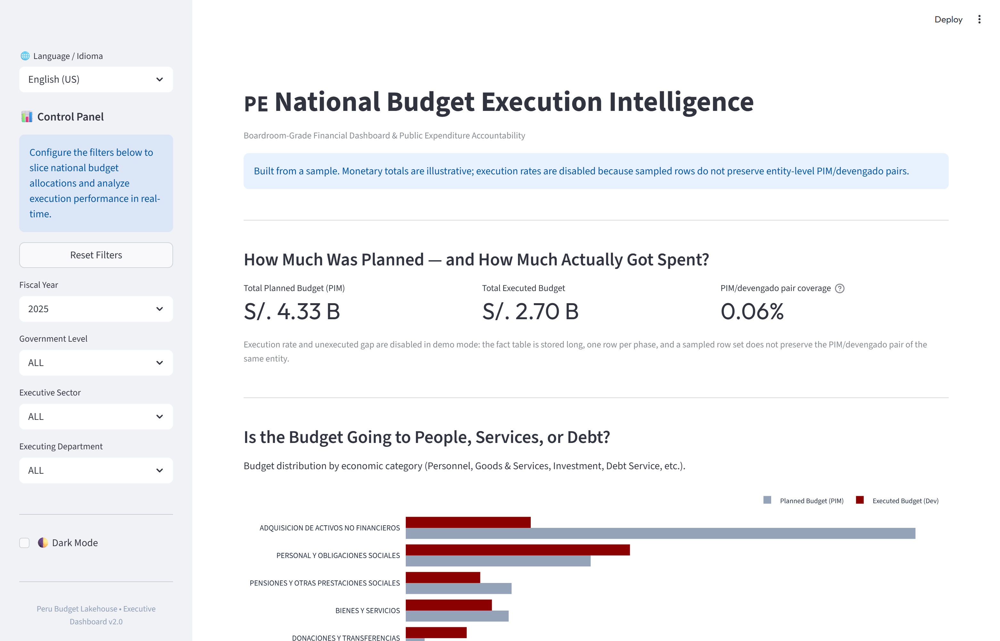
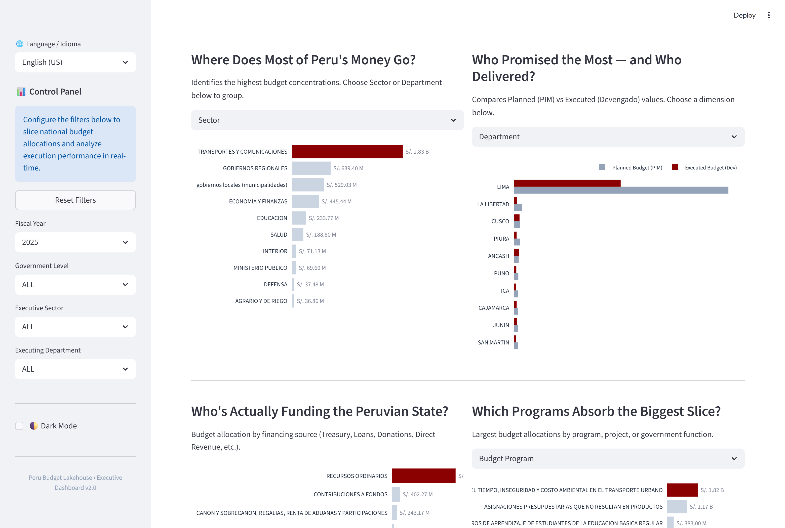
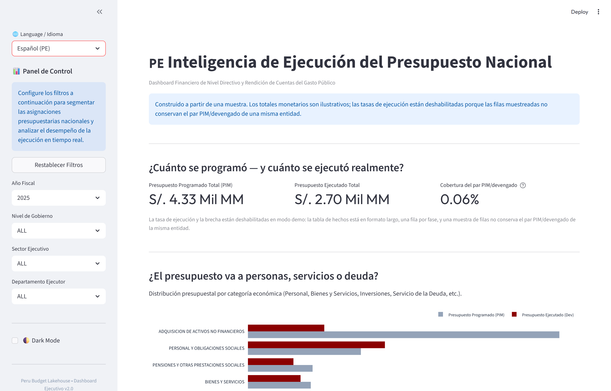

# Peru Budget Lakehouse

**An analytics engineering pipeline that turns Peru's national budget execution file — 8,002,563 rows across 88 columns — into a 29,530,978-row Kimball star schema, a bilingual executive dashboard, and a conversational layer that answers budget questions in SQL.**

**English** · [Español](README.es.md)

---

## Dashboard Preview







The live views run on the 450,000-row demo sample included in `data/00_demo/`.
How and why the demo disables two KPIs is documented in [Known limitations](#known-limitations).

---

## The Business Problem

Peru's Ministry of Economy and Finance publishes budget execution as one wide spreadsheet: 88 columns, one per phase per fiscal year (`pia_2022`, `pim_2022`, `devengado_2022`, … `girado_2026`). Every question a financial analyst actually needs — *which regions execute least?*, *how much of the planned budget was actually spent?*, *who funds the state?* — requires pivoting 35 financial columns into a workable shape first.

That reshape is where the work disappears. Every answer gets rebuilt from scratch: a new pivot, a new vlookup chain, a new reconciliation nobody wrote down. The numbers move between copies and no one can say which file is the truth.

This pipeline does the reshape once and makes one reconciled table the single source for every downstream answer — SQL reports, the dashboard, and the conversational layer.

The domain is not theoretical: it comes from years of auditing financial statements, reconciling ledgers and testing controls, where a cent of unexplained difference between two reports is a finding, not a rounding error.

## The Data

| | |
|---|---|
| Source | [MEF open data — Comparación de Presupuesto y Ejecución de Gasto](https://datosabiertos.mef.gob.pe/dataset/comparacion-de-presupuesto-ejecucion-gasto) |
| Raw file | 8,002,563 rows × 88 columns |
| Financial columns | 35 (7 phases × 5 fiscal years) |
| Gold fact table | **29,530,978** rows |
| Dimension tables | 5 — geography 1,892 · institution 2,905 · programmatic 345,402 · economic 579 · financing 316 |
| Fiscal years | 2022–2026; 2026 is cloned source data and is excluded from every query |
| Grain | one row per institution × geography × program × economic classifier × funding source × year × phase |

Every figure above is printed by an execution saved in the notebooks, not estimated. Sources are listed in [Where the numbers come from](#where-the-numbers-come-from).

## Architecture

```
RAW CSV  (8,002,563 rows × 88 columns)
        │
        ▼
┌──────────────────────────────────────┐
│ BRONZE — Polars streaming            │
│ CSV → Parquet (ZSTD), no full load   │
└───────────────┬──────────────────────┘
                ▼
┌──────────────────────────────────────┐
│ SILVER — normalization               │
│ column names, types, case, accents   │
└───────────────┬──────────────────────┘
                ▼
┌──────────────────────────────────────┐
│ SILVER — unpivot                     │
│ DuckDB: 35 wide columns → long       │
│ → 29,530,978 facts (phase, year)     │
└───────────────┬──────────────────────┘
                ▼
┌──────────────────────────────────────┐
│ GOLD — Kimball star schema           │
│ 1 fact + 5 dimensions, wyhash SKs    │
└──────┬───────────────────────────────┘
       │
  ┌────┴─────────────────────┐
  ▼                          ▼
QA GATE                 Streamlit dashboard
Σ Silver = Σ Gold       deterministic DuckDB reports
S/. 0.00 difference     conversational NL → SQL → answer
```

Orchestration is a Prefect flow with explicit `wait_for=` dependencies: a stage cannot start before its predecessor finishes, regardless of scheduler configuration.

## Engineering Decisions

**Polars streaming instead of Pandas.**
`scan_csv` / `sink_parquet` read and write in batches; the 88-column source is never materialized at once. The trade-off is a narrower API surface and no DataFrame conveniences — you write plans, not loops. That was acceptable because the job must run on a workstation, not a cluster.

**DuckDB owns exactly one transformation.**
Reshaping 35 wide columns into long format is the memory peak of the whole pipeline. DuckDB's vectorized `UNPIVOT` runs under an explicit `PRAGMA memory_limit` with spilling to a temp directory, so the operation degrades in speed instead of failing. Polars owns everything else. Two engines instead of one is the price; the failure mode is the reason.

**`polars-hash` instead of `pl.hash()`.**
`pl.hash()` does not guarantee identical output across Polars versions. A version bump would silently break every foreign key between fact and dimensions — joins return zero rows, with no error. wyhash keys are stable across versions and still execute inside the streaming engine, unlike `map_elements`.

**`ignore_nulls=True` on surrogate keys — a real bug, not a precaution.**
Municipal entities frequently have `pliego = NULL`. Without `ignore_nulls=True`, one NULL collapses the concatenated key expression to NULL, and thousands of municipalities share the same key. Silent collision, plausible-looking aggregates. The fix is at `src/etl_04_star_schema.py:111` and `:137`.

**Reconciliation is a gate, not a warning.**
The pipeline sums `monto` in Silver and Gold and raises `ValueError` when `abs(Σ silver − Σ gold) > 0.01` (`src/etl_05_data_quality_audit.py:23`). No report runs until the two layers tie out. This is the control logic of an accounting system, applied to a data pipeline: there is no downstream output while the numbers disagree.

## Data Quality Gates

| Gate | Logic | On failure |
|---|---|---|
| Financial reconciliation | `abs(Σ Silver − Σ Gold) ≤ S/. 0.01` | `ValueError`, pipeline halts |
| Row volumetrics | Silver clean rows == Gold fact rows | Warning logged with the gap |
| SQL safety | `SELECT`/`WITH` only, 22 forbidden keywords (`sqlparse`) | Query rejected before execution |
| SQL semantics | column scope, aggregation consistency, CTE graph, grain | Query rejected before execution |

The last recorded full-data run reconciled both layers at **S/. 5,373,286,978,810.52** with a difference of **S/. 0.00**.

## What the Data Says

All figures below come from the last recorded full-data run, saved in `notebooks/`.

**The planned budget grew 17.0% over four years.** PIM rose from S/ 147.06 billion in 2022 to S/ 172.07 billion in 2025.

**Execution in 2022 was 88.6%.** S/ 130.29 billion devengado against S/ 147.06 billion PIM — the remaining 11.4% is the gap between what was budgeted and what was actually spent.

**Spending is geographically concentrated by construction.** In 2024, executing units in Lima reported S/ 91.43 billion devengado; Cusco, the second department, reported S/ 5.63 billion — a 16.2× difference. National ministries execute in Lima, so this is a property of the Peruvian state, not a data artefact.

**2026 is a clone of 2025.** PIM for both years is S/ 172.067633 billion to the last digit. The pipeline acknowledges the duplication instead of silently averaging it: the analytical layer appends `anio <= 2025` to every generated query.

## Conversational Analytics

Natural language → SQL → DuckDB → structured executive answer. Two LLM calls per question on Groq (`llama-3.3-70b-versatile`):

1. **Translate** — a 205-line schema description, business rules and 7 worked examples produce SQL.
2. **Synthesize** — question, SQL and result rows produce structured JSON: intent, headline metric, chart spec, insights, follow-up questions.

Two independent validators run between generation and execution: `QueryValidationPolicy` (single statement, `SELECT`/`WITH` only, 22 forbidden keywords) and `SQLSemanticContractValidator` (column scope, aggregation consistency, CTE dependency graph, grain family). The model never sees raw data.

The interface is fully bilingual: every label, chart and answer follows the language selector.

## Quick Start

**Docker** — no local Python required:

```bash
git clone https://github.com/DaelFame/peru-budget-lakehouse.git
cd peru-budget-lakehouse
docker build -t peru-budget-lakehouse .
docker run -p 8501:8501 peru-budget-lakehouse
```

Dashboard at `http://localhost:8501`, served from the demo layer baked into the image. To use your own Gold layer instead:

```bash
docker run -p 8501:8501 -v "$(pwd)/data:/app/data" peru-budget-lakehouse
```

**Local:**

```bash
uv sync
uv run streamlit run app.py
```

**Full pipeline** — requires the source CSV at `data/01_bronze/comparativo_gastos_2022_2026.csv` (download it from the MEF portal; neither the CSV nor the Gold layer is committed):

```bash
uv run python main.py
```

Individual stages run the same way:

```bash
uv run python src/etl_01_bronze_ingestion.py
uv run python src/etl_02_silver_cleaning.py
uv run python src/etl_03_silver_unpivot.py
uv run python src/etl_04_star_schema.py
uv run python src/etl_05_data_quality_audit.py
uv run python src/etl_06_analytical_reports.py
```

The conversational layer needs `GROQ_API_KEY`. Without it the dashboard still renders every deterministic view and says so.

**Tests:** `uv run pytest` — 131 tests, including an end-to-end render of the dashboard and the demo-sampling acceptance gates.

## Known Limitations

**The committed demo is a row-level sample, and the dashboard says so.** Drawing individual rows from a long-format fact table keeps a `pim` fact while dropping the `devengado` fact of the same entity. The ratio then compares different entities: the shipped sample reports impossible execution rates. Demo mode therefore hides the execution rate and the unexecuted gap, explains why on the card, and reports PIM/devengado pair coverage instead — the share of entity-years that actually carry both phases. In the committed sample that coverage is 0.06%; a correct entity-level sample reports a valid rate. Monetary totals stay visible and are labelled illustrative: they are a subset of the real ledger, not the national total.

**Regenerating the demo correctly.** `scripts/build_demo_dataset.py` now samples whole entities — every year and phase of a selected record is kept — and refuses to write a demo whose global or per-year execution rate leaves [0, 100]. Geographic concentration is reported, never enforced: Lima concentrates PIM because national ministries execute there. Run it on a machine that holds `data/03_gold/`:

```bash
uv run python scripts/build_demo_dataset.py
```

It writes `data/00_demo/*.parquet` plus `manifest.json` with the parameters, row counts and validation output. `uv run python scripts/demo_stats.py` re-derives every demo figure quoted here.

**No benchmark is committed.** The pipeline logs per-stage durations at `INFO`; no timing or memory figure appears in this README because no run JSON is versioned. Run `uv run python main.py` for numbers on your hardware.

**The Docker image is not built in CI.** The documented commands work from the repository layout; the image build itself is unverified here.

**159,981 source rows share a duplicate `KEY_VALUE` (2.0% of the file).** They are kept, not silently dropped: the reconciliation gate compares Silver against Gold, so it cannot detect a duplicate that reaches both layers. Deduplicating needs a business rule the source does not provide.

**`GrainRouter` is not wired into the engine.** Pre-LLM grain classification exists and is covered by tests, but `AIEngine.ask()` does not call it yet. The sidebar filters are likewise not passed into the LLM context.

**2026 is excluded, not corrected.** The source repeats 2025 in the 2026 columns; the pipeline filters it out rather than attempting to repair the export.

## Where the Numbers Come From

| Figure | Source |
|---|---|
| 8,002,563 source rows; 159,981 duplicate keys | `notebooks/01_ingesta_silver.ipynb:335-337` |
| 88 columns; 35 financial columns | `notebooks/01_ingesta_silver.ipynb:181`, `:607` |
| 29,530,978 fact rows | `notebooks/02_modelado_gold.ipynb:448`, `notebooks/03_auditoria_calidad.ipynb:220` |
| Dimension row counts | `notebooks/02_modelado_gold.ipynb:61, 135, 210, 287, 366` |
| Reconciliation total and difference | `notebooks/03_auditoria_calidad.ipynb:64-66` |
| PIM by fiscal year; 2022 devengado | `notebooks/04_reportes_gerenciales.ipynb:156-160`, `notebooks/03:134` |
| Lima and Cusco devengado 2024 | `notebooks/04_reportes_gerenciales.ipynb:90-91` |
| Demo row counts and coverage | `uv run python scripts/demo_stats.py` |
| 22 forbidden keywords; 7 examples; 205-line schema | `src/dashboard/ai_engine.py:30-35`, `:174-263`, `:60-264` |
| 131 tests | `uv run pytest` |

## What to Read First

| File | What it demonstrates |
|---|---|
| `src/etl_03_silver_unpivot.py` | The unbounded-memory reshape, delegated to DuckDB |
| `src/etl_04_star_schema.py` | Surrogate keys, `ignore_nulls=True`, streaming dimensions |
| `src/etl_05_data_quality_audit.py` | Reconciliation as a hard gate |
| `src/dashboard/semantic_contract.py` | SQL validation: scope, aggregation, CTE graph, grain |
| `src/dashboard/ai_engine.py` | Two-call NL→SQL→answer pipeline and its prompt contract |
| `scripts/build_demo_dataset.py` | Entity-level sampling with acceptance gates |
| `main.py` | Prefect `wait_for=` dependency chain |

## Repository Structure

```
peru-budget-lakehouse/
├── main.py                     Prefect orchestration entry point
├── app.py                      Streamlit dashboard (bilingual)
├── src/
│   ├── config.py               Paths, hardware detection, demo/production resolver
│   ├── etl_01..06              Bronze → Silver → Gold → QA → reports
│   ├── dashboard/              Queries, components, AI engine, semantic validator
│   └── observability/          Query execution trace model
├── scripts/                    Demo builder, demo stats, determinism checker
├── tests/                      131 tests
├── sql/                        Four executive reports
├── notebooks/                  Exploratory analysis with recorded outputs
├── data/00_demo/               Committed 450,000-row demo layer
└── assets/                     Dashboard screenshots
```

`data/01_bronze/`, `data/02_silver/` and `data/03_gold/` are gitignored: they are regenerated by the pipeline.

## Stack

| Tool | Role |
|---|---|
| Polars | Streaming ingestion and normalization |
| DuckDB | UNPIVOT and embedded OLAP over Parquet |
| polars-hash | Version-stable wyhash surrogate keys |
| Prefect | Orchestration with explicit dependencies |
| Groq / llama-3.3-70b | NL→SQL translation and answer synthesis |
| Streamlit + Plotly | Dashboard and conversational UI |
| Parquet + ZSTD | Columnar storage with predicate pushdown |
| Docker | Reproducible runtime |
| GitHub Actions | CI: full test suite on every push and PR |
| uv | Dependency resolution and lockfile |

## Roadmap

- [x] Medallion pipeline: Bronze → Silver → Gold, streaming at every layer
- [x] Kimball star schema: 1 fact + 5 dimensions with stable surrogate keys
- [x] Financial reconciliation as a blocking gate
- [x] Prefect orchestration with explicit ordering
- [x] Deterministic DuckDB report layer
- [x] Bilingual dashboard with conversational analytics and SQL guardrails
- [x] Entity-level demo sampler with acceptance gates
- [ ] Wire `GrainRouter` into `AIEngine.ask()`
- [ ] Pass active sidebar filters into the LLM context
- [ ] Remote Parquet reads (DuckDB S3 extension)
- [ ] Regenerate the committed demo from a full pipeline run

---

[LinkedIn](https://www.linkedin.com/in/joaquin-cardenas-956a0a218) · [GitHub](https://github.com/DaelFame)
